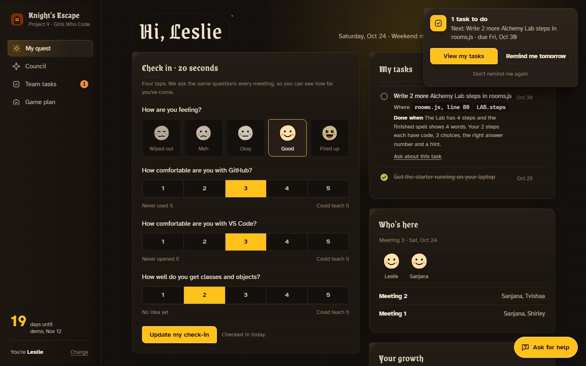
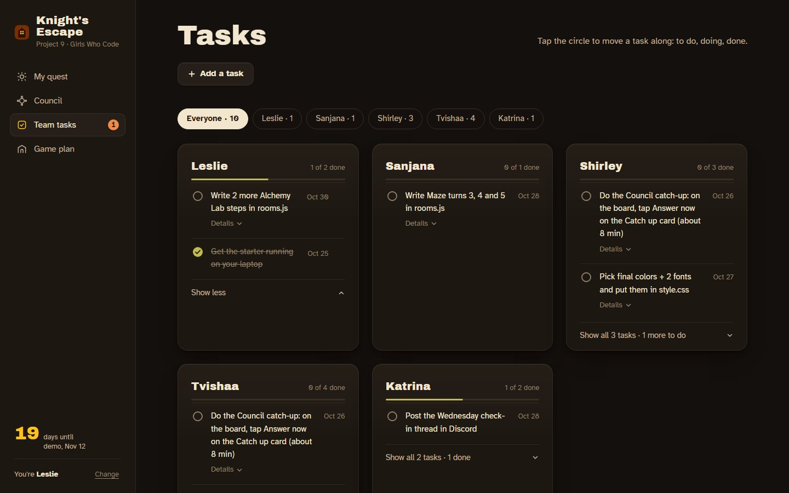
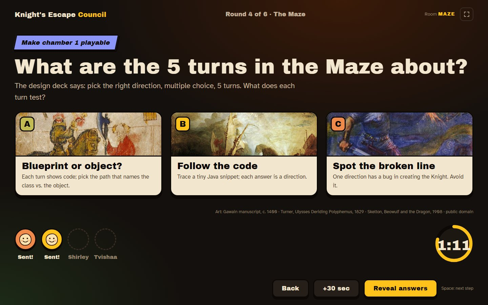
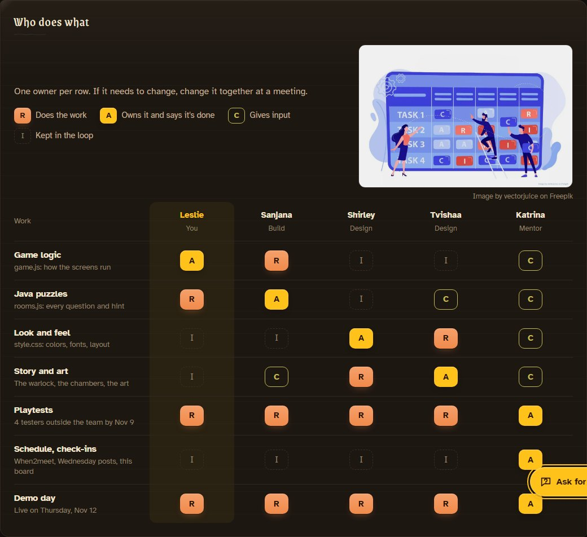
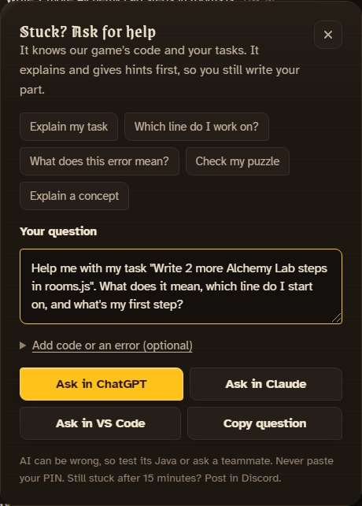
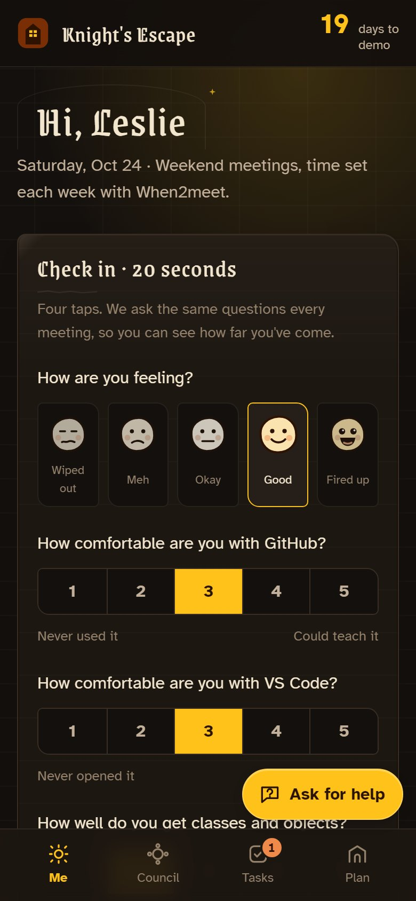
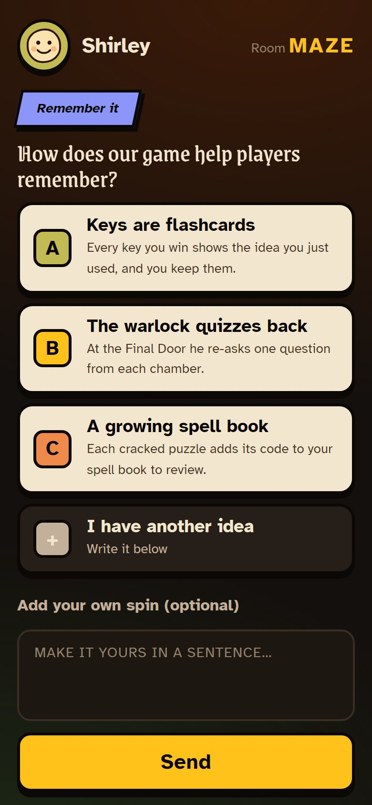
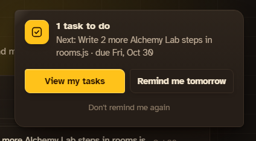
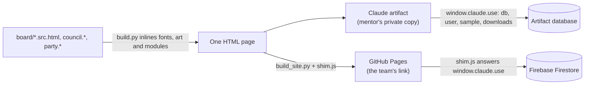

# Knight's Escape · Team Board

**Four students, one escape room, one demo day. The board keeps everyone on the same quest.**

A team workspace for Girls Who Code Project 9, where four students build a Java OOP escape room for college students. Check-ins, tasks that say exactly where to start, a phone party game for team decisions, and a live mentor view, in one page with no build step.

**🏰 Team board: [kateye31.github.io/pm-gwc-proj9](https://kateye31.github.io/pm-gwc-proj9/)** · **🎮 Council game: [/party](https://kateye31.github.io/pm-gwc-proj9/party/)** · **📖 [Team guide](escape-room-starter/TEAM-GUIDE.md)**

<p>
  
  
  
  
  <br>
  
  
  
  <br>
  
  
  
  
</p>



Demo day is **Thursday, November 12, 2026**. The game design is Tvishaa's (the Group 9 design roadmap: a warlock, four chambers). The OOP teaching plan is Sanjana's research. Leslie and Sanjana build, Shirley and Tvishaa design, and Katrina mentors.

## What it does

The board has four screens, plus one only the mentor sees. Each person opens a personal link (`#leslie`, `#sanjana`…), signs in once with a 4-digit PIN on a phone-style keypad (or pastes it), and stays signed in on that device.

- **My quest.** A 20-second check-in (mood plus GitHub, VS Code and OOP comfort from 1 to 5) that charts each person's growth over the weeks. Her own tasks, each with **where to start** (`rooms.js, line 80 · LAB.steps`) and **what done looks like**. Who came to the latest meeting, and a short history of earlier ones.
- **Stuck? Ask for help**, a floating button on every screen. Questions go out with the project already explained: the starter's real code with line numbers and her open tasks. So "which line do I work on?" gets a real answer. The AI is told to give hints first and not write the task for her. On claude.ai it answers on the page; on the public site it opens ChatGPT or Claude with the question filled in, and **Ask in VS Code** copies a version for the AI chat inside VS Code, which can read the repo.
- **Team tasks.** Everyone's tasks, calm by default: the next 2 per person, with **Show all** and **Details** one tap away. Your own card comes first, open, with a **You** tag. A badge on the nav counts your unfinished tasks, and a reminder shows once per visit.
- **Council.** A party game for team decisions, inspired by Jackbox: the mentor streams the big screen, everyone answers on their phone, and the answers are revealed together. Missed the meeting? **Catch-up mode** walks you through the rounds you missed, with no timer and no screenshare.
- **Game plan.** The dungeon map (four chambers and what each teaches), the schedule to demo day, and a charter with a **who-does-what (RACI) matrix** and a risk register.
- **Live** (mentor only). A card per student, attendance per meeting, the Council in real time, results and notes that write themselves as Markdown, a meeting timer, and "see the site as…" previews.

<table>
  <tr>
    <td width="50%"></td>
    <td width="50%"></td>
  </tr>
  <tr>
    <td><b>Team tasks.</b> The next 2 per person, the rest one tap away.</td>
    <td><b>Council, big screen.</b> Public-domain art on every card.</td>
  </tr>
  <tr>
    <td></td>
    <td></td>
  </tr>
  <tr>
    <td><b>Who does what.</b> Owners in gold, doers in orange, and it still reads in grayscale.</td>
    <td><b>Ask for help.</b> Knows the code and your tasks; gives hints first.</td>
  </tr>
</table>

### On a phone

<table>
  <tr>
    <td width="33%"></td>
    <td width="33%"></td>
    <td width="33%"></td>
  </tr>
  <tr>
    <td><b>My quest.</b> Bottom tabs and a task badge.</td>
    <td><b>Council on your phone.</b> Live, or catch up later.</td>
    <td><b>The reminder.</b> Once per visit. Snooze it or turn it off.</td>
  </tr>
</table>

### The mentor's Live page


## How it works

The board is one HTML page that runs in two places. The code never changes between them; only the thing that answers `window.claude.use(...)` does.



1. **Data, not hardcoded records.** Everything people change lives in a small database: `tasks`, `checkins` (`<date>_<name>`), `workshop_sessions` (the live Council round and meeting attendance), `workshop_answers` and `party_players`. The page subscribes to them, so every open screen updates live.
2. **Two hosts, same calls.** On claude.ai the artifact runtime provides `db`, `user` (is this the owner?), `sample` (inline AI answers) and `downloads`. On GitHub Pages, [`board/site/shim.js`](board/site/shim.js) answers the same calls with Firestore, so the girls get a link that needs no sign-in.
3. **The Council is shared state.** The host screen writes the round and timer to `workshop_sessions/meeting-1`, each phone writes its own answer, and everyone renders from the same records. Phones join with a 4-letter room code that changes every day.
4. **Reminders stay on the device.** The badge counts your open tasks. The reminder shows once per visit, and "Remind me tomorrow" or "Don't remind me again" are saved in that browser only.
5. **The mentor edits the board in place.** Every task has an Edit button for her (title, owner, due date, Done when, and steps she can drag into order). "Edit the board" lets her rewrite any text, hide or drag cards, and add her own cards. Each change is a `kind: "page"` record in `workshop_sessions`, so the team sees it at once, and the page source never changes. Saved text is cleaned to bold, italics, code and links before it's shown. A text edit only applies while the original it replaced is still there, so a later source change can't misplace it.

## Privacy and safety

The team is four students, so the board stores as little as possible.

- **First names only.** No emails, accounts or real passwords. PINs are stored as SHA-256 hashes, never as the PIN.
- **A PIN is a light gate, not real security.** It stops classmates from checking in as each other. The real protection is the Firestore rules: only the board's own collections, at most 12 fields per record, and everything expires on Dec 31, 2026.
- **The mentor view** unlocks with a key whose hash is in [`config.js`](docs/config.js); the key itself is never in the repo.
- **The Discord kit stays private.** Its posts include notes about the students, so `build.py` puts it inside Live on the mentor's private Claude copy only. The public site and this repo never contain it.
- **Art is human-made.** Public-domain paintings and manuscripts (Wikimedia Commons), credited on the page where they appear: the Round Table (Lancelot manuscript, BnF MS fr. 120, c. 1400), Gawain (Cotton Nero A.x, c. 1400), J. M. W. Turner's *Ulysses Deriding Polyphemus* (1829) and J. R. Skelton's *Beowulf and the Dragon* (1908). The RACI card uses one licensed illustration, *Image by vectorjuice on Freepik*, credited under it. No AI-generated images.
- **These screenshots use sample check-ins.** Tasks, meetings and Council answers are the team's; moods and skill ratings are made up, so nobody's real ratings are in a public README.

## Design

- **One dark theme**, "lantern-lit dungeon": warm near-black wood with a faint stone-block texture, carved card corners, thin gothic arches on screen titles, and torch gold only for what is live or primary. Buttons are matte, with no shine or glow. Every color is a `:root` token.
- **Readable first.** Body text is [Atkinson Hyperlegible](https://www.brailleinstitute.org/freefont/), designed for low-vision readers. Titles use a castle face: the team's font on claude.ai, and [Grenze Gotisch](https://fonts.google.com/specimen/Grenze+Gotisch) (open license) on the public site, chosen after comparing 8 fonts on the real headings. Buttons, letters, room codes and numbers always use bold Atkinson, because blackletter is hard to read small.
- **Checked, not eyeballed.** A Playwright audit runs every screen at laptop and phone width and flags any title-font text under 18px and any text under 4.5:1 contrast. An 8px spacing scale, soft shadows tinted with the wood color (never pure black), and a grayscale check keep the hierarchy clear.
- **Motion that stays out of the way.** Transform and opacity only, under 300 ms, ease-out, and turned off for anyone who prefers reduced motion.

## Run it yourself

No install for the game: open `escape-room-starter/index.html` in a browser. To work on the board:

```bash
# Rebuild the board after editing board/*.src.html (inlines fonts, art, Council and party modules)
python board/build.py

# Rebuild the public site into docs/ (open fonts, Firebase shim)
python board/build_site.py

# Browser QA (needs Chrome): two-device Council sync, catch-up, every screen at phone width
node board/checks/browser-qa.cjs
```

To run your own copy, paste your Firebase web config into [`docs/config.js`](docs/config.js), or leave it as `null` for demo mode, which saves on one computer only.

## Project layout

| Path | What's in it |
| --- | --- |
| [`board/quest-board.src.html`](board/quest-board.src.html) | The board: markup, styles and logic for every screen |
| [`board/council.*`](board/council.js) | The Council rounds, shared by the board and the party game |
| [`board/party.*`](board/party.js) | Party mode: `#host` big screen and `#play` phone controller |
| [`board/site/`](board/site/) | The GitHub Pages shim (Firebase or demo store) and its config |
| [`board/checks/`](board/checks/) | Browser QA that drives Chrome over the DevTools protocol |
| [`docs/`](docs/) | The built public site (GitHub Pages serves this folder) |
| [`escape-room-starter/`](escape-room-starter/) | The students' game: `rooms.js` (puzzles as data), `game.js`, `style.css`, and the [Team guide](escape-room-starter/TEAM-GUIDE.md) |

## Credits

Built for Girls Who Code Project 9 by mentor **Katrina** ([@kateye31](https://github.com/kateye31)) with **Leslie, Sanjana, Shirley and Tvishaa**. Game design by Tvishaa, OOP research by Sanjana. Code written with Claude Code and Codex.
